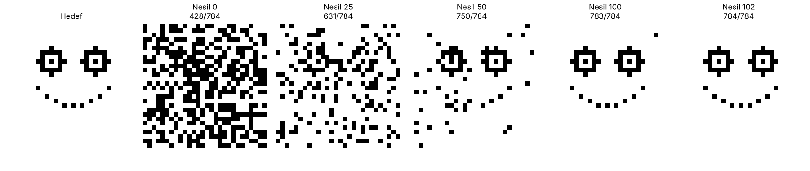
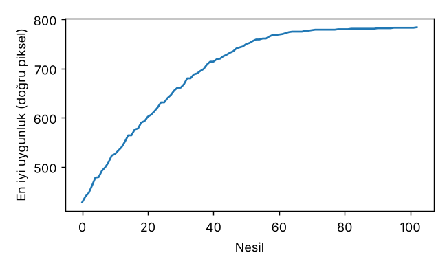

# Genetik Algoritma ile Gülen Yüz Üretimi

[English](README.md) | **Türkçe**

28x28 piksellik beyaz bir görüntüde, elle çizilmiş bir gülen yüz taslağını (iki göz ve kesik çizgili gülümseme) genetik algoritma ile sıfırdan evrimleştiren küçük bir deneme.



## Nasıl çalışıyor?

| Bileşen | Seçim |
|---|---|
| Birey | 784 bitlik dizi (28x28 piksel, 1 = siyah, 0 = beyaz) |
| Başlangıç | Rastgele gürültü |
| Uygunluk | Hedefle eşleşen piksel sayısı (en fazla 784) |
| Seçilim | Turnuva seçimi (boyut 3) |
| Çaprazlama | Uniform çaprazlama |
| Mutasyon | Gen başına 1/784 olasılıkla bit çevirme |
| Elitizm | En iyi 2 birey bir sonraki nesle aynen aktarılır |
| Popülasyon | 200 birey |

Hedef görüntü `hedef_olustur()` fonksiyonunda koordinatlarla tanımlanır: iki göz (halka ve ortada nokta) ile parabol şeklinde dizilmiş kesik çizgili gülümseme.

## Sonuç

Sabit tohumla (`seed=42`) algoritma **102. nesilde** 784/784 piksele ulaşır.



## Kullanım

```bash
pip install numpy matplotlib
python ga_smiley.py
```

Çalıştırınca konsola son nesil ve en iyi uygunluk yazılır, ayrıca şu dosyalar üretilir:

- `evrim.png`: hedef ile seçili nesillerdeki (0, 25, 50, 100, ...) en iyi bireyler
- `uygunluk.png`: nesillere göre en iyi uygunluk grafiği

## Notlar

Uygunluk doğrudan hedef görüntüyle karşılaştırıldığı için bu problem genetik algoritma açısından kolaydır (OneMax benzeri). Daha ilginç bir sürüm için birey; göz konumu, yarıçap ve gülümseme eğrisi gibi birkaç parametreyle temsil edilebilir.

## Dosyalar

- `ga_smiley.py`: algoritma ve görselleştirme
- `evrim.png`, `uygunluk.png`: örnek çıktılar
